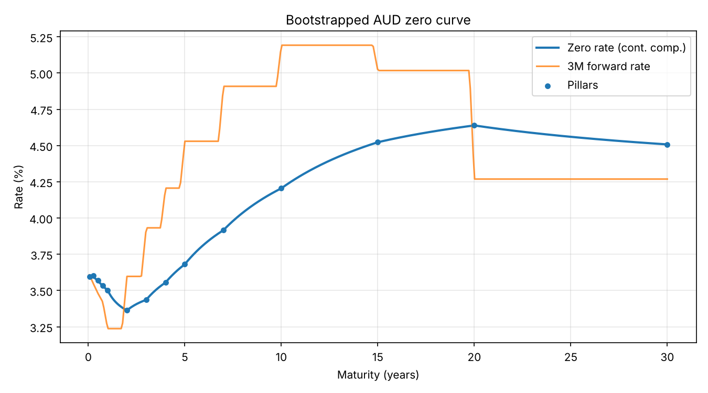

# AUD Yield Curve Bootstrapper

A small Python library that builds an Australian dollar zero-coupon curve from market quotes: BBSW deposits, FRAs and par interest rate swaps. Every input instrument reprices exactly on the finished curve.



## Why

Trading and risk systems need a discount curve before they can price almost anything. Market quotes come as deposit rates, FRA rates and swap rates, none of which are zero rates. Bootstrapping turns those quotes into discount factors one maturity at a time. This repo shows the method end to end in about 200 lines of readable code.

## How it works

1. Quotes are sorted by maturity.
2. Deposits give a discount factor directly: `DF = 1 / (1 + r * t)`.
3. FRAs extend the curve from the previous pillar: `DF(end) = DF(start) / (1 + r * (end - start))`.
4. Swaps are solved with Brent's method. The new pillar's discount factor is chosen so the swap's par rate equals the quoted rate. A root solver is needed because coupon dates can fall between pillars and depend on the unknown segment.
5. Discount factors are interpolated log-linearly, which gives piecewise flat forward rates (the steps in the chart).

AUD conventions used: swaps up to 3 years pay quarterly against 3M BBSW, longer swaps pay semi-annually against 6M BBSW.

## Quick start

```bash
pip install -r requirements.txt
python -m yieldcurve data/sample_aud_rates.csv --plot docs/curve.png
pytest
```

Sample output:

```
Pillar (y)         DF   Zero %  Reprice err (bp)
    1.0000   0.965585   3.5021          0.00e+00
    5.0000   0.831894   3.6810          1.39e-13
   10.0000   0.656719   4.2050         -1.39e-13
   30.0000   0.258621   4.5080          0.00e+00
```

## Use as a library

```python
from yieldcurve import Deposit, FRA, Swap, bootstrap

curve = bootstrap([
    Deposit(0.25, 0.0362),
    FRA(0.25, 0.5, 0.0355),
    Swap(2, 0.0338),
    Swap(5, 0.0370),
    Swap(10, 0.0418),
])

curve.df(7.5)                # discount factor
curve.zero_rate(7.5)         # continuously compounded zero rate
curve.forward_rate(5, 5.25)  # 3M forward starting in 5 years
```

## Input format

`data/sample_aud_rates.csv` (rates in percent, times in years):

| type    | start | maturity | rate |
|---------|-------|----------|------|
| deposit | 0     | 0.25     | 3.62 |
| fra     | 0.25  | 0.5      | 3.55 |
| swap    | 0     | 10       | 4.18 |

The sample rates are illustrative, not live market data.

## Simplifications

- Single curve: the same curve projects floating rates and discounts cash flows. Production desks use OIS (AONIA) discounting with separate 3M and 6M BBSW projection curves.
- Times are year fractions rather than real calendar dates, so there are no business-day adjustments, holidays or spot lags.
- Log-linear interpolation is simple and stable but produces stepped forwards. Monotone convex or cubic spline methods give smoother forwards.

## Possible next steps

- Dual-curve bootstrap with AONIA OIS discounting
- Real date schedules with Sydney holiday calendar
- Bucketed DV01 by bumping each input quote
- Alternative interpolation methods compared side by side

## License

MIT
